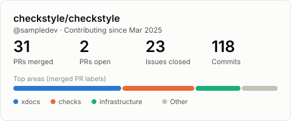

# contrib-card

A dynamically rendered SVG card of **your contributions to a specific open-source repo** — embeddable in any GitHub README. No more hardcoded numbers: the card re-fetches live data from the GitHub API and GitHub's image cache keeps it fast.



## What it shows

- PRs merged / PRs open (authored by you in that repo)
- Issues closed (assigned to you)
- Total commits
- Lines added (from GitHub's contributor stats — covers a repo's top 100 contributors; "—" outside that)
- "Contributing since" (your first PR there)
- Top areas — a segmented bar of the labels on your merged PRs

## Embed it

Once deployed, add one line to your profile README (or a GSoC proposal, or anywhere markdown renders):

```markdown

```

Dark theme: append `&theme=dark`.

### Multi-repo card

One card listing several repos — **the URL is the configuration**: list exactly the repos you want shown, in the order you want them (up to 5):

```markdown

```

Each row shows PRs merged, issues closed, commits, and when you started contributing there. To change which repos appear, just edit the list in your README — no redeploy, no config file.

## Deploy your own (free, ~3 minutes)

[](https://vercel.com/new/clone?repository-url=https%3A%2F%2Fgithub.com%2Fsmita1078%2Fcontrib-card)

Everyone runs their **own** free instance — your cards, your rate limits, no dependency on anyone else's server.

1. Click the button above (or push this folder to a GitHub repo and import it at vercel.com).
2. Go to [vercel.com](https://vercel.com) → **Add New Project** → import the repo → **Deploy** (no configuration needed; `api/card.js` is auto-detected as a serverless function).
3. Recommended: in Vercel → Project → Settings → Environment Variables, add `GITHUB_TOKEN` = a [fine-grained personal access token](https://github.com/settings/tokens) with **public repo read-only** access. Without it you share the unauthenticated GitHub rate limit (10 searches/min per IP), which is fine for testing but not for real traffic.

Responses are CDN-cached for 6 hours (`s-maxage=21600`), so even a popular card costs almost no API calls.

## Local preview

```bash
# live data (optionally: export GITHUB_TOKEN=...)
node scripts/preview.js --user smita1078 --repo checkstyle/checkstyle -o card.svg

# multi-repo card
node scripts/preview.js --user smita1078 --repos checkstyle/checkstyle,checkstyle/contribution -o multi.svg

# offline, from fixture data
node scripts/preview.js --fixture fixtures/sample.json --theme dark -o card-dark.svg
node scripts/preview.js --fixture fixtures/multi.json -o multi.svg
```

Zero dependencies — plain Node 18+.

## How it works

| Stat | Source |
|---|---|
| PRs merged / open | Search API: `repo:R author:U is:pr is:merged` / `is:open` |
| Issues closed | Search API: `repo:R assignee:U is:issue is:closed` |
| Commits | `GET /repos/R/commits?author=U&per_page=1` → `Link` header's last-page number |
| Lines added | `GET /repos/R/stats/contributors` (lazily computed by GitHub; first hit may briefly return nothing — a warm cache fixes this) |
| Since | earliest PR via `sort=created&order=asc` |
| Top areas | labels aggregated over your 100 most recent merged PRs |

GitHub READMEs only allow images (served through GitHub's camo proxy) — no iframes or scripts — which is why the card is a server-rendered static SVG.

## Roadmap ideas

- `?issues=author` switch for projects that don't use assignees
- Repo-side card for maintainers: live good-first-issue count, time-to-first-review
- Per-area drill-down page the card links to

## License

MIT
